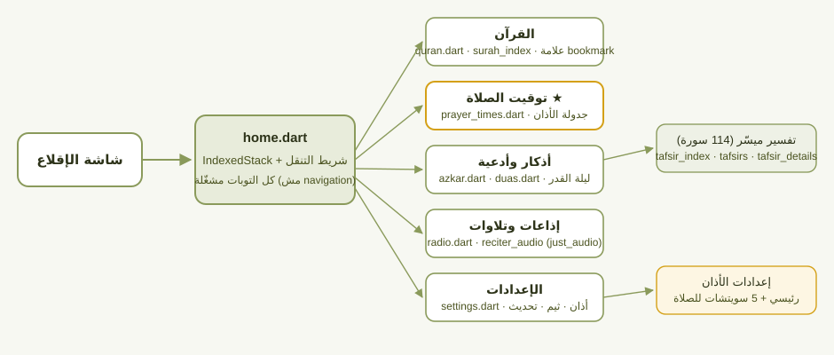
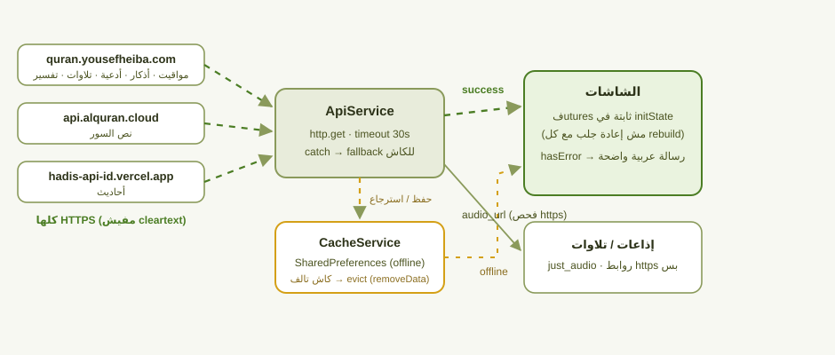
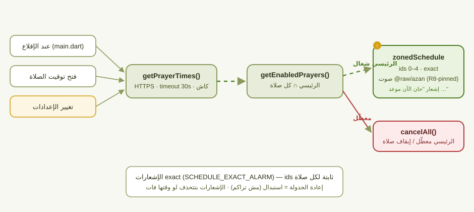

# islami

تطبيق أندرويد إسلامي مبني بـ **Flutter** — يعرض القرآن (سور + علامة مرجعية)، مواقيت الصلاة مع تنبيهات أذان، أذكار، أدعية، تفسير (ميسّر)، أحاديث، إذاعات إسلامية، وتلاوات القراء بالصوت.

الإصدار الحالي: **1.0.3+17**. مفيش حسابات، مفيش مصادقة، ومفيش أي بيانات شخصية (PII) — كل المحتوى ديني عام بيتجلب من APIs عامة.

## خريطة التطبيق

<details open>



</details>

## انسياب البيانات (API → كاش → شاشات)



## دورة الأذان



## تشغيل المشروع

```bash
flutter pub get
flutter run            # على جهاز / محاكي (debug)
flutter analyze        # مفيش issues متوقع
flutter test           # 31 اختبر هيرمتيكي + 4 اختبارات شبكة محتاجة نت
```

## البناء والتوقيع

```bash
flutter build apk --release
```

- الـ release بيتوقععلّى **مفتاح release حقيقي**: `android/app/islami-release.keystore` (مش مرفوع git)، وبيانات التوقيع في `android/key.properties` (مش مرفوع git). لو بنّيت من clone جديد، أنشئ keystore بـ `keytool -genkeypair` وملف `key.properties` بنفس الـ keys (`storeFile`, `storePassword`, `keyAlias`, `keyPassword`).
- **ملاحظة:** لو عندك نسخة قديمة مثبّتة موقعة بمفتاح تاني، لازم تنسفها الأول (signature mismatch).
- صوت الأذان (`android/app/src/main/res/raw/azan.mp3`) بيتحذف تلقائيًا في بناءات release بسبب R8 resource shrinking — مرفوق بمينب `meta-data android:resource="@raw/azan"` في الـ manifest عشان الـ shrinking يسيبه.
- SHA-256 للـ APK بيتولّد جنبه (`Get-FileHash`) وينتشر جنب ملف التحميل عشان المستخدم يتأكد من سلامة النسخة.

## هيكل الكود

```
lib/
├── main.dart                    # الإقلاع: أذونات، Shorebird auto-update، جدولة أذان اليوم، الـ providers
├── Screen/
│   ├── home.dart                # الـ IndexedStack للتوبات + شريط التنقل
│   ├── splash_screen.dart
│   └── HomeTab/
│       ├── quran.dart           # قراءة صفحات القرآن (صفحات مولّدة)
│       ├── surah_index_screen.dart
│       ├── prayer_times.dart    # مواقيت اليوم + جدولة إشعارات الأذان
│       ├── azkar.dart / azkar_screen.dart
│       ├── duas.dart / duas_screen.dart
│       ├── tafsir_index_screen.dart / tafsirs.dart / tafsir_details_screen.dart
│       ├── laylat_al_qadr_screen.dart
│       ├── radio.dart           # 12 إذاعة ثابتة + مفضلة
│       ├── reciter_audio_screen.dart  # تلاوات القراء (just_audio، تشغيل backend)
│       └── settings.dart        # الثيم + إعدادات الأذان + زر التحديث (Shorebird)
├── dezeen/                      # ثيمات/ألوان، حالة صفحات القرآن (shiar.dart)، أسماء السور، بيانات
├── models/                      # fromJson لكل API responses (PrayerTimes مشدّد ضد الـ nulls)
├── services/
│   ├── api_service.dart         # كل الجلبات (30 ثانية timeout) + fallback لكاش محلي
│   ├── cache_service.dart       # تغليف SharedPreferences للكاش + evict للتالف
│   ├── notification_service.dart# أذان: master + per-prayer gating، zonedSchedule بصوت azan
│   └── (dezeen/connectivity_service.dart)
└── l10n/                        # عربي/إنجليزي
```

## المصادر والتخزين

**APIs (كلها HTTPS):**
- `quran.yousefheiba.com` — مواقيت الصلاة، أذكار، أدعية، تفسير، فهرس السور، ليلة القدر، تلاوات القراء، إذاعات
- `api.alquran.cloud` — نص السور
- `hadis-api-id.vercel.app` — أحاديث

**كاش محلي:** استجابات الـ APIs JSON محفوظة في SharedPreferences (`cache_service.dart`) فكل سكرين يشتغل offline. كاش تالف بيتقشط تلقائيًا (evict) بدل ما يوقع التطبيق.

**كل اللي على القرص (جرد كامل — مفيش حساس):**
| المفتاح | النوع |
|---|---|
| `quran_bookmark` | int (علامة القراءة) |
| `radio_favorites` | JSON list من ids |
| `adhan_master` + `adhan_fajr`…`adhan_isha` | bools (إعدادات الأذان) |
| `*_cache_*` | JSON من الـ APIs |

## إعدادات الأذان

- مفتاح رئيسي "تشغيل الأذان" + سويتش لكل صلاة في صفحة الإعدادات (بيتحفظ في SharedPreferences، **افتراضي: كله شغال**).
- الجدولة: `zonedSchedule` بإشعارات exact (ids ثابتة 0–4 لكل صلاة → إعادة الجدولة = استبدال مش تراكم)، صوت `@raw/azan`، وبيتجدول: عند الإقلاع، وفتح توقيت الصلاة، وأي تغيير في الإعدادات.
- إيقاف الرئيسية بيلغي كل الإشعارات المجدولة.

## الموثوقية والأمان (ملخص التدقيق 2026-11-02)

- كل الطلبات HTTPS — مفيش cleartext (اتقفلت راية `usesCleartextTraffic` ورابط `api.alquran.cloud` اتحول).
- كل `http.get` عنده timeout 30 ثانية — اتصال راكد بيفلت للكاش مش تعليق.
- روابط الصوت الخارجية (من API) متحقق منها: `https://` بس.
- رداءة الـ JSON من الـ APIs محمية: catch + fallback، و`PrayerTimes.fromJson` مشدّد.
- الـ R8 minify + resource shrinking مفعّلين في release.
- تحديثات الكود (Shorebird): كل patch بيتوقّع بمفتاح المنظمة بيتحقق منه على الجهاز — مفيش حقن.
- مفيش WebView، مفيش `Image.network`، مفيش مصادقة → ما فيش قناة لسرقه بيانات.

## الاختبارات

`flutter test` (7 ملفات): الاختبارات الهيرمتكية (models/كاش/إعدادات الأذان) شغالة من غير نت — آخر جولة: 27 نجاح / 1 skip / 4 فشل، والفشل كلّه اختبارات الشبكة الحيّة في `test/api_test.dart` اللي محتاجة نت فعلاً.
